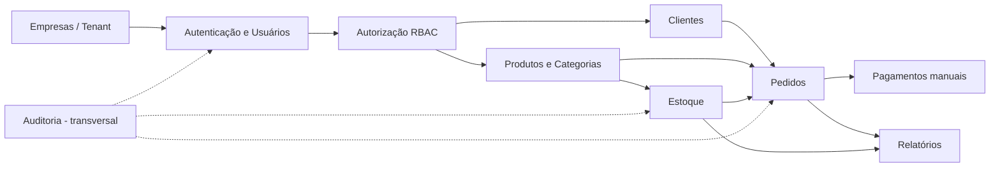
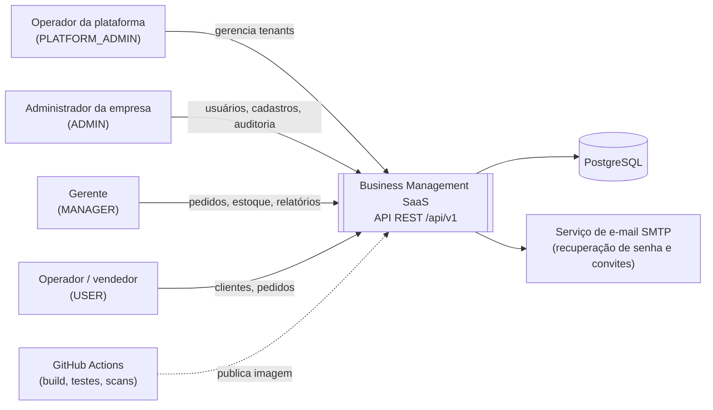
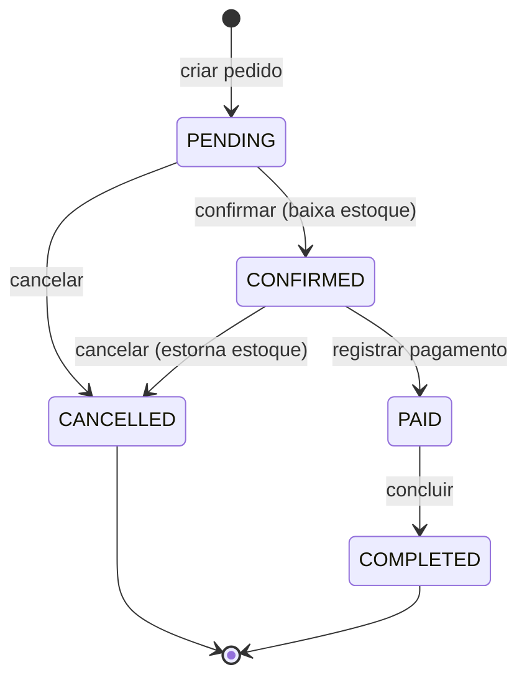

# 01 — Visão do Produto e Descoberta (Fase 1)

| Campo | Valor |
|---|---|
| Produto | Business Management SaaS (repositório: `Orderflow`) |
| Documento | Visão do produto — resultado da Fase 1 (Descoberta e planejamento) |
| Versão | 1.1 — **aprovado em 2026-11-06**, todas as decisões da Fase 1 fechadas (ver 14.3) |
| Data | 2026-11-06 |
| Autores | Guilherme Braga (desenvolvedor), Claude (tech lead / revisor) |
| Próxima fase | Fase 2 — Requisitos e regras de negócio (`02-requirements.md`, `03-business-rules.md`) |

> **Como ler este documento.** Ele não descreve *como* o sistema será construído — isso é papel das Fases 3 e 4. Ele fixa *o quê* e *por quê*: para quem é o produto, que problema resolve, o que entra no MVP, o que ainda está ambíguo e quais decisões precisam ser tomadas antes de desenhar qualquer tabela ou classe. Toda afirmação marcada como **hipótese** ou **recomendação** está aberta à sua revisão.

---

## Sumário

1. [Conceitos desta fase](#1-conceitos-desta-fase)
2. [Declaração de visão](#2-declaração-de-visão)
3. [Análise do escopo](#3-análise-do-escopo)
4. [Problemas que o sistema resolve](#4-problemas-que-o-sistema-resolve)
5. [Stakeholders e personas](#5-stakeholders-e-personas)
6. [Objetivos do produto e métricas de sucesso](#6-objetivos-do-produto-e-métricas-de-sucesso)
7. [Ambiguidades identificadas](#7-ambiguidades-identificadas)
8. [Definição do MVP](#8-definição-do-mvp)
9. [Requisitos funcionais preliminares](#9-requisitos-funcionais-preliminares)
10. [Requisitos não funcionais preliminares](#10-requisitos-não-funcionais-preliminares)
11. [Premissas de volume](#11-premissas-de-volume)
12. [Riscos técnicos e de negócio](#12-riscos-técnicos-e-de-negócio)
13. [Stack: versões verificadas](#13-stack-versões-verificadas)
14. [Decisões necessárias antes da modelagem](#14-decisões-necessárias-antes-da-modelagem)
15. [Cronograma e encaixe no plano de 6 semanas](#15-cronograma-e-encaixe-no-plano-de-6-semanas)
16. [Critérios de aceite desta fase](#16-critérios-de-aceite-desta-fase)
17. [Glossário](#17-glossário)
18. [Fontes](#18-fontes)

---

## 1. Conceitos desta fase

Antes de aplicar, vale alinhar o vocabulário. São conceitos que você vai usar em entrevistas e no dia a dia.

**Documento de visão.** Um contrato curto entre quem decide e quem constrói. O valor dele não está em ser completo, e sim em tornar explícito o que estava implícito — principalmente o que **não** será feito. Um time que pula essa etapa costuma descobrir na semana 4 que "pagamentos" significava três coisas diferentes para três pessoas.

**MVP (Minimum Viable Product).** O menor conjunto de funcionalidades que entrega o valor central e permite aprender algo. "Mínimo" não é "malfeito": no MVP a segurança, o isolamento entre tenants e a integridade do estoque são inegociáveis; o que se corta é *amplitude* (menos recursos), nunca *qualidade* (menos testes, menos validação).

**Requisito funcional vs. não funcional.** Funcional diz o que o sistema faz ("cancelar um pedido estorna o estoque"). Não funcional diz *quão bem* ou *sob quais restrições* ele faz ("nenhuma venda concorrente deixa o estoque negativo", "p95 abaixo de 300 ms"). Requisitos não funcionais costumam determinar a arquitetura mais do que os funcionais.

**Tenant.** Cada empresa cliente da plataforma. Multi-tenancy é servir vários tenants com uma única instalação, mantendo os dados de cada um invisíveis aos demais.

**Por que decidir antes de modelar.** Algumas respostas mudam o desenho do banco de forma cara de reverter. Exemplo: se um usuário pode pertencer a várias empresas, a tabela `users` deixa de ter `tenant_id` e surge uma tabela de associação; o login, o JWT e os testes mudam junto. Por isso a seção 14 existe.

---

## 2. Declaração de visão

Formato clássico (Geoffrey Moore), útil para testar se a ideia cabe em um parágrafo:

> **Para** pequenas e médias empresas que vendem produtos físicos
> **que** hoje controlam clientes, estoque e pedidos em planilhas ou sistemas desconectados,
> **o** Business Management SaaS **é** uma plataforma web multiempresa
> **que** centraliza cadastro, estoque, pedidos e indicadores com controle de acesso por perfil e trilha de auditoria.
> **Diferente de** planilhas compartilhadas e de ERPs pesados instalados por cliente,
> **nosso produto** garante consistência de estoque sob concorrência, isolamento rigoroso entre empresas e rastreabilidade de quem fez o quê — com custo de operação compartilhado entre os tenants.

**Contexto real do projeto.** Este é também um projeto de formação profissional e portfólio. Isso cria um segundo "produto": o próprio repositório, que será lido por avaliadores e recrutadores. Os dois objetivos convivem bem, desde que fique claro (seção 6) quando uma decisão é tomada por valor de negócio e quando é tomada por valor de aprendizado.

---

## 3. Análise do escopo

### 3.1 O que foi pedido

O escopo declarado tem nove módulos (Empresas, Autenticação/Usuários, Autorização, Clientes, Produtos, Pedidos, Estoque, Auditoria, Relatórios), mais "Pagamentos", que aparece na lista de objetivos mas **não tem módulo definido** (ver A5).

### 3.2 Leitura de tech lead

- **O núcleo de valor é Pedidos + Estoque.** É onde estão as regras difíceis: cálculo, máquina de estados, concorrência, consistência transacional. Clientes e Produtos são cadastros de apoio; Relatórios são leitura sobre dados que os outros módulos produzem.
- **O núcleo de risco é Multi-tenancy + Autenticação/Autorização.** Um erro aqui não é um bug, é um incidente de vazamento de dados. Por isso esses módulos vêm primeiro e têm a barra de teste mais alta.
- **O escopo completo é grande para o prazo.** O plano do projeto prevê 6 semanas para 10 fases. Nove módulos com testes de integração, segurança e concorrência dificilmente cabem nesse prazo com a qualidade exigida. A seção 8 propõe um corte de MVP e a seção 15 discute o cronograma com honestidade.
- **Há dependências de ordem.** Pedidos dependem de Clientes, Produtos e Estoque; Relatórios dependem de Pedidos e Estoque; Auditoria é transversal; tudo depende de Tenant + Auth.

*Diagrama 1 — dependências entre módulos. Define a ordem de implementação da Fase 6.*

### 3.3 Contexto do sistema

*Diagrama 2 — contexto (equivalente ao nível 1 do C4). Mostra que o MVP é **API-only**: não há frontend no escopo (ver A16).*

---

## 4. Problemas que o sistema resolve

| ID | Problema | Quem sente | Consequência hoje |
|---|---|---|---|
| P1 | Cadastros de clientes e produtos espalhados em planilhas e mensagens | Operadores, gerentes | Duplicidade, dados desatualizados, preço errado no pedido |
| P2 | Estoque não reflete as vendas em tempo real | Gerentes, vendedores | Venda de produto sem saldo, compras emergenciais, retrabalho |
| P3 | Todos acessam tudo, sem perfis e sem registro de alterações | Donos, administradores | Impossível saber quem alterou um preço ou cancelou um pedido |
| P4 | Ausência de visão consolidada de vendas | Donos, gerentes | Decisões baseadas em intuição; produtos parados não são identificados |
| P5 | Ciclo de vida do pedido informal | Vendedores, financeiro | Pedidos "esquecidos", cancelamentos sem estorno de estoque |
| P6 | Ter um sistema próprio por empresa é caro de instalar e manter | Pequenas empresas | Ficam presas a planilhas por falta de opção acessível |
| P7 | *(lado da plataforma)* Operar muitas empresas em uma base sem vazar dados | Operador do SaaS | Um único vazamento entre tenants compromete a confiança no produto inteiro |

---

## 5. Stakeholders e personas

### 5.1 Stakeholders

| Stakeholder | Interesse principal | Influência | Participação no projeto |
|---|---|---|---|
| Guilherme (desenvolvedor) | Construir o sistema e desenvolver competências de backend | Alta | Decide, implementa, valida |
| Tech lead / revisor | Qualidade de engenharia, segurança, sustentabilidade | Alta | Orienta, revisa, questiona decisões |
| Operador da plataforma (dono do SaaS) | Saúde da operação, isolamento, custo | Alta | Persona; gerencia tenants |
| Empresa cliente (tenant) | Controlar vendas e estoque com segurança | Alta | Persona; fonte dos requisitos funcionais |
| Avaliadores acadêmicos / recrutadores | Ver evidência de boas práticas | Média | Leitores do repositório, docs e pipeline |
| Clientes finais das empresas | Ter seus dados pessoais tratados corretamente (LGPD) | Baixa direta, alta legal | Não usam o sistema; são **titulares de dados** armazenados nele |
| *Futuro:* contador / financeiro da empresa | Relatórios confiáveis | Baixa no MVP | Fora do MVP |

### 5.2 Personas

**Ana — Administradora da empresa (ADMIN).** Sócia de uma distribuidora com 8 funcionários. Cadastra a empresa, convida a equipe, define quem pode alterar preços. Quer saber quem cancelou um pedido. Não é técnica; espera mensagens de erro claras.

**Bruno — Gerente (MANAGER).** Responsável pelo estoque e pelas vendas. Registra entradas de mercadoria, confirma e cancela pedidos, acompanha produtos mais vendidos. Seu maior medo: vender o que não tem.

**Carla — Vendedora (USER).** Cadastra clientes e cria pedidos. Não pode alterar preço nem estoque diretamente. Precisa de buscas rápidas por nome ou documento.

**Diego — Operador da plataforma (PLATFORM_ADMIN).** Opera o SaaS. Ativa e desativa empresas. **Não** deve enxergar dados de negócio dos tenants (clientes, pedidos) — essa é uma decisão proposta em D5.

---

## 6. Objetivos do produto e métricas de sucesso

Objetivos sem métrica não podem ser verificados. Cada um abaixo tem um critério observável.

### 6.1 Objetivos de produto

| ID | Objetivo | Métrica / evidência de sucesso |
|---|---|---|
| OBJ-1 | Isolamento total entre empresas | 100% dos endpoints de recursos com teste automatizado de acesso cruzado; zero falhas |
| OBJ-2 | Estoque consistente sob concorrência | Teste com N requisições simultâneas sobre o mesmo produto nunca resulta em saldo negativo nem em baixa duplicada |
| OBJ-3 | Ciclo de pedido rastreável | Todo pedido tem histórico de status com autor e horário; transições inválidas são rejeitadas |
| OBJ-4 | Controle de acesso por perfil | Matriz papel × permissão documentada e coberta por testes de API (permitido e negado) |
| OBJ-5 | Rastreabilidade de operações sensíveis | Lista fechada de eventos auditáveis, todos com ator, tenant, ação, entidade e horário |
| OBJ-6 | Visão gerencial básica | Relatórios do MVP respondem em < 2 s com o volume de referência (seção 11) |

### 6.2 Objetivos de engenharia e aprendizado

| ID | Objetivo | Evidência |
|---|---|---|
| ENG-1 | Ambiente reproduzível | `docker compose up` sobe API + banco em máquina limpa, com migrations aplicadas |
| ENG-2 | Pipeline como porteiro | Merge em `main` bloqueado se build, testes, análise estática ou scan de vulnerabilidades falharem |
| ENG-3 | Decisões explicadas | Toda decisão relevante registrada como ADR em `11-decisions-adr.md` |
| ENG-4 | Domínio das competências-alvo | Você consegue explicar e defender: isolamento de tenant, fluxo JWT/refresh, controle de concorrência no estoque, estratégia de testes |

---

## 7. Ambiguidades identificadas

Cada ambiguidade tem uma **recomendação padrão**. Se você não tiver preferência, aprovar o documento significa aceitar as recomendações; elas serão detalhadas e formalizadas nas Fases 2 e 4.

| ID | Ambiguidade | Por que importa | Recomendação padrão |
|---|---|---|---|
| A1 | O produto se chama "Business Management SaaS", mas o repositório se chama **Orderflow** | Nome aparece em pacotes Java (`com.xxx.orderflow`), imagens Docker, docs | Manter **Orderflow** como nome técnico (pacote, artefato, imagem) e "Business Management SaaS" como descrição |
| A2 | Quem cria uma empresa? Cadastro público (self-service) ou só o operador da plataforma? | Define o fluxo de "registro" e quais endpoints são públicos | **Onboarding self-service**: uma operação pública cria empresa + primeiro ADMIN, em uma única transação |
| A3 | "Registro" no módulo 2: qualquer pessoa pode se registrar como usuário de uma empresa existente? | Registro público em empresa existente é uma falha de segurança em B2B | **Não.** Usuários adicionais só entram por criação/convite do ADMIN |
| A4 | Um usuário pertence a **uma** ou a **várias** empresas? ("Usuários estarão associados a empresas") | Muda tabela de usuários, unicidade de e-mail, login e claims do JWT | **Uma empresa por usuário no MVP.** E-mail único por tenant ou global — ver D4 |
| A5 | "Pagamentos" aparece nos objetivos, mas não há módulo. Significa: (a) registrar que o pedido foi pago, (b) integrar com gateway, ou (c) cobrar a assinatura do SaaS? | São três sistemas completamente diferentes | **(a) registro manual** do pagamento do pedido. (b) e (c) fora do MVP |
| A6 | O que significa "acessar outra empresa com autorização explícita e validada"? Suporte técnico? Holding com várias filiais? | Abre uma porta de acesso cruzado que precisa de desenho próprio | **Nenhum acesso cruzado a dados de negócio no MVP.** PLATFORM_ADMIN opera só sobre o cadastro de tenants |
| A7 | Quando o estoque é baixado: na criação, na confirmação ou no faturamento do pedido? Existe reserva? | Define a máquina de estados e a estratégia transacional | **Baixa na confirmação**, sem reserva. Ver proposta em 14.2 |
| A8 | Pedido tem desconto, frete, impostos? | Impostos no Brasil (NF-e, ICMS) são um domínio inteiro | **Sem impostos e frete no MVP.** Desconto por item: decidir na Fase 2 |
| A9 | Moeda única ou várias? | Tipo de dado, arredondamento, relatórios | **BRL única**, `NUMERIC` no banco e `BigDecimal` no Java |
| A10 | Um depósito ou vários? Lotes, validade? | Muda a modelagem de estoque | **Um único local de estoque por tenant**, sem lote/validade |
| A11 | Categorias hierárquicas (árvore) ou planas? | Consultas recursivas têm custo de modelagem e teste | **Planas**, uma categoria por produto |
| A12 | Clientes são PF, PJ ou ambos? Documento obrigatório? | Validação (CPF/CNPJ), unicidade e LGPD | **PF e PJ**, documento opcional mas único por tenant quando informado |
| A13 | Excluir significa apagar ou inativar? | Pedidos referenciam clientes e produtos; LGPD exige poder eliminar dado pessoal | **Inativação** para clientes/produtos com histórico; **anonimização** como caminho LGPD; exclusão física só para registros sem vínculo |
| A14 | Papéis fixos (ADMIN, MANAGER, USER) ou papéis customizáveis por empresa? | Customizável exige telas, tabelas e testes extras | **Papéis fixos mapeados para permissões granulares** no código; customização pós-MVP |
| A15 | Quem emite o JWT: a própria aplicação ou um provedor externo (Keycloak, Auth0)? | Muda dependências, infraestrutura e o que você aprende | **A própria aplicação**, com Spring Security. Ver D6 |
| A16 | Existe frontend? Quem consome a API? | Define transporte do token (header vs cookie) e, portanto, a necessidade de CSRF | **API-only no MVP**, consumida via Swagger UI / cliente HTTP, token no header `Authorization` |
| A17 | Recuperação de senha exige envio de e-mail: qual provedor? | Infraestrutura e testes | **SMTP**; em desenvolvimento, um capturador de e-mail local (ex.: Mailpit) no Compose |
| A18 | Relatórios: em qual fuso horário? "Vendas de hoje" depende disso | Bugs de borda de dia/mês | Datas gravadas em **UTC**; relatórios no **fuso configurado do tenant** (padrão `America/Sao_Paulo`) |
| A19 | Quais operações são "importantes" para auditoria? Por quanto tempo guardar? | Volume de dados e custo | Lista fechada na Fase 2; retenção padrão de 12 meses (hipótese) |
| A20 | Onde será feito o deploy? | Custo, segredos, HTTPS, banco gerenciado | Decidir na Fase 4; MVP precisa rodar localmente via Compose e em **um** provedor de nuvem |
| A21 | Qual volume esperado? | Índices, paginação, metas de desempenho | Hipóteses na seção 11 |
| A22 | Repositório usa **GPL v2**. Era intencional? | Ver risco R14 — compatibilidade de licença e efeito nulo da GPL em SaaS | Revisar licença (D2) |
| A23 | Idioma do código e da API | Consistência e portfólio internacional | **Código, API e commits em inglês; documentação em português** |

---

## 8. Definição do MVP

### 8.1 Critério de corte

Entra no MVP o que for necessário para **um pedido percorrer o ciclo completo com segurança**: empresa criada → usuários com papéis → cliente e produto cadastrados → estoque abastecido → pedido criado, confirmado (baixa estoque), pago e concluído — ou cancelado (estorna estoque) — com tudo auditado e visível em relatórios básicos.

### 8.2 Escopo (MoSCoW)

| Módulo | Must (MVP) | Should (MVP se couber) | Won't (fora do MVP) |
|---|---|---|---|
| Empresas | Onboarding self-service; consultar/editar própria empresa; ativar/desativar tenant (PLATFORM_ADMIN) | — | Planos, assinatura e cobrança do SaaS |
| Auth / Usuários | Login; access + refresh token com rotação; logout; recuperação de senha; ADMIN gerencia usuários | "Sair de todas as sessões"; convite por e-mail | SSO/OAuth social; MFA; usuário em várias empresas |
| Autorização | RBAC com 3 papéis fixos → permissões granulares; isolamento por tenant em toda operação | — | Papéis customizáveis; acesso de suporte a tenants |
| Clientes | CRUD; PF/PJ; validação; busca paginada | Anonimização LGPD | Importação em massa |
| Produtos | CRUD; SKU único por tenant; preço; categoria plana; ativar/desativar | — | Variações, imagens, categorias hierárquicas |
| Estoque | Entrada, saída, ajuste; histórico imutável; saldo nunca negativo sob concorrência | Alerta de estoque mínimo | Múltiplos depósitos, lotes, reserva |
| Pedidos | Criar com itens; preço congelado; total calculado no servidor; máquina de estados; cancelamento com estorno; histórico | Desconto por item | Devolução após pagamento; frete; impostos/NF-e |
| Pagamentos | — | Registro manual de pagamento integral do pedido | Gateway; pagamento parcial; reembolso |
| Auditoria | Registro das operações da lista fechada | Consulta pelo ADMIN | Exportação; integração SIEM |
| Relatórios | Histórico de movimentações | Resumo de pedidos; top produtos; resumo financeiro | Dashboards; exportação CSV/PDF |

> **Observação do tech lead.** "Pagamentos" e "Relatórios" ficaram em *Should* de propósito. Eles são leitura ou anotação sobre o núcleo; se o prazo apertar, cortá-los preserva um produto coerente. Cortar testes de concorrência do estoque, por outro lado, produziria um produto que *parece* pronto e não está.

### 8.3 Fora do escopo do produto (registrado para não voltar como surpresa)

Frontend; aplicativo mobile; emissão de nota fiscal; integração contábil; marketplace; mensageria/eventos assíncronos entre serviços; microsserviços; cache distribuído; multi-tenancy por schema ou por banco; internacionalização.

---

## 9. Requisitos funcionais preliminares

Preliminares significa: serão detalhados com regras, cenários e critérios de aceite na Fase 2. A numeração será mantida para rastreabilidade.

### Empresas
| ID | Requisito | Prioridade |
|---|---|---|
| RF-01 | Onboarding público cria empresa e primeiro usuário ADMIN em uma única transação | Must |
| RF-02 | ADMIN consulta e atualiza os dados da própria empresa | Must |
| RF-03 | PLATFORM_ADMIN lista, ativa e desativa empresas | Must |
| RF-04 | Usuários de empresa desativada não autenticam, e requisições com tokens já emitidos passam a ser rejeitadas | Must |

### Autenticação e usuários
| ID | Requisito | Prioridade |
|---|---|---|
| RF-05 | Login com e-mail e senha retorna access token (curta duração) e refresh token | Must |
| RF-06 | Renovação por refresh token com rotação; reuso de refresh token já usado revoga a família de tokens | Must |
| RF-07 | Logout revoga a sessão atual | Must |
| RF-08 | Recuperação de senha por token de uso único com expiração; a resposta não revela se o e-mail existe | Must |
| RF-09 | ADMIN cria, edita, desativa usuários do próprio tenant e define o papel; o novo usuário define a própria senha por link (reaproveita RF-08) | Must |
| RF-10 | Usuário consulta o próprio perfil e altera a própria senha mediante senha atual | Should |
| RF-11 | Encerrar todas as sessões do usuário | Should |

### Autorização
| ID | Requisito | Prioridade |
|---|---|---|
| RF-12 | Papéis fixos ADMIN, MANAGER e USER mapeados para permissões granulares (ex.: `product:write`) | Must |
| RF-13 | Toda operação verifica autenticação, permissão e pertencimento do recurso ao tenant do usuário | Must |

### Clientes
| ID | Requisito | Prioridade |
|---|---|---|
| RF-14 | CRUD de clientes PF e PJ com validação de CPF/CNPJ e e-mail | Must |
| RF-15 | Documento único por tenant quando informado | Must |
| RF-16 | Busca por nome ou documento com paginação e ordenação | Must |
| RF-17 | Cliente com pedidos não é excluído fisicamente; é inativado | Must |
| RF-18 | Anonimização de cliente a pedido do titular (LGPD), preservando pedidos | Should |

### Produtos
| ID | Requisito | Prioridade |
|---|---|---|
| RF-19 | CRUD de produtos com SKU único por tenant, nome, preço e categoria | Must |
| RF-20 | CRUD de categorias planas por tenant | Must |
| RF-21 | Ativar e desativar produto; produto inativo não pode ser adicionado a pedidos | Must |
| RF-22 | Busca por nome, SKU, categoria e status, paginada | Must |

### Estoque
| ID | Requisito | Prioridade |
|---|---|---|
| RF-23 | Registrar entrada, saída e ajuste com motivo; movimentações são imutáveis | Must |
| RF-24 | O saldo nunca fica negativo, inclusive sob requisições concorrentes | Must |
| RF-25 | Consultar saldo atual e histórico de movimentações por produto e período | Must |
| RF-26 | Indicar produtos abaixo do estoque mínimo configurado | Should |

### Pedidos
| ID | Requisito | Prioridade |
|---|---|---|
| RF-27 | Criar pedido para cliente ativo, com ao menos um item, produtos ativos e quantidades positivas | Must |
| RF-28 | Preço unitário copiado do produto no momento da criação; total sempre calculado no servidor | Must |
| RF-29 | Transições de status seguem a máquina de estados; transição inválida é rejeitada | Must |
| RF-30 | Confirmar pedido baixa o estoque de todos os itens atomicamente (tudo ou nada) | Must |
| RF-31 | Cancelar pedido confirmado estorna o estoque | Must |
| RF-32 | Histórico de status com autor, horário, estado anterior e novo | Must |
| RF-33 | Listar pedidos com filtros por status, cliente e período, paginado | Must |
| RF-34 | Registrar pagamento manual integral (método, data); pedido passa a PAGO | Should |

### Auditoria
| ID | Requisito | Prioridade |
|---|---|---|
| RF-35 | Registrar eventos da lista fechada com ator, tenant, ação, tipo e id da entidade, horário e id de correlação da requisição | Must |
| RF-36 | ADMIN consulta a auditoria do próprio tenant com filtros e paginação | Should |

### Relatórios
| ID | Requisito | Prioridade |
|---|---|---|
| RF-37 | Resumo de pedidos por status e período | Should |
| RF-38 | Top N produtos mais vendidos por período (quantidade e valor) | Should |
| RF-39 | Resumo financeiro: valor pago vs. pendente por período | Should |

---

## 10. Requisitos não funcionais preliminares

| ID | Categoria | Requisito |
|---|---|---|
| RNF-01 | Isolamento | O tenant é derivado exclusivamente da identidade autenticada, nunca de parâmetro, header ou corpo enviado pelo cliente |
| RNF-02 | Isolamento | Recurso de outro tenant responde **404**, não 403 — para não confirmar que o id existe |
| RNF-03 | Segurança | Senhas com Argon2id ou BCrypt; parâmetros de custo definidos em ADR |
| RNF-04 | Segurança | Access token assinado, curta duração (ordem de 15 min), validação de assinatura, `iss`, `aud` e `exp`; refresh token opaco armazenado apenas como hash |
| RNF-05 | Segurança | Limitação de tentativas em login e recuperação de senha; mensagens de erro genéricas |
| RNF-06 | Segurança | Referência: OWASP Top 10 e **OWASP API Security Top 10** (o item nº 1 é BOLA — exatamente o risco de acesso cruzado) |
| RNF-07 | Segurança | Nenhum segredo no repositório; secret scanning habilitado no GitHub; tokens e senhas nunca em logs |
| RNF-08 | Integridade | Pedido e estoque com garantias ACID; invariantes críticas também como constraints no banco (ex.: saldo ≥ 0) |
| RNF-09 | Desempenho | p95 < 300 ms para leituras paginadas e < 500 ms para confirmação de pedido, sob a carga de referência (hipótese, validada na Fase 7) |
| RNF-10 | Desempenho | Toda listagem é paginada, com tamanho máximo de página (proposta: 100) |
| RNF-11 | Observabilidade | Logs estruturados com id de correlação e tenant; health checks de liveness/readiness; métricas básicas |
| RNF-12 | Privacidade | LGPD: minimização de dados, mascaramento de dados pessoais em logs, caminho de anonimização. A plataforma atua como **operadora**; cada empresa é **controladora** dos dados dos seus clientes |
| RNF-13 | Tempo | Instantes gravados em UTC (`timestamptz` / `Instant`); apresentação no fuso do tenant |
| RNF-14 | Dinheiro | `NUMERIC` no banco e `BigDecimal` no Java; regra de arredondamento definida e testada na Fase 2 |
| RNF-15 | API | Prefixo `/api/v1`; contrato OpenAPI gerado; erros no formato padronizado **RFC 9457 (Problem Details)** |
| RNF-16 | Manutenibilidade | Organização por domínio (package-by-feature); cobertura medida com JaCoCo como *sinal*, não como meta isolada |
| RNF-17 | Portabilidade | Sobe com Docker Compose em máquina limpa; imagem com usuário não-root |
| RNF-18 | Entrega | Pipeline bloqueia merge/deploy com testes falhando, quality gate reprovado ou vulnerabilidade crítica/alta sem justificativa |
| RNF-19 | Recuperação | Backup diário do banco com **restore testado**; RPO 24 h e RTO 4 h (hipóteses para o contexto do projeto) |

---

## 11. Premissas de volume

Números para guiar índices, paginação e testes de carga. São **hipóteses** — o importante é que estejam escritas, para que decisões de desempenho tenham uma referência.

| Grandeza | Valor de referência |
|---|---|
| Tenants ativos | até 100 |
| Usuários por tenant | até 50 |
| Clientes por tenant | até 50.000 |
| Produtos por tenant | até 10.000 |
| Pedidos por tenant por dia | até 1.000 (média 5 itens) |
| Pico de requisições na plataforma | 50 req/s |
| Usuários concorrentes alterando o mesmo produto | até 20 (cenário do teste de concorrência) |

Consequência prática: o volume cabe com folga em **uma** instância PostgreSQL bem indexada. Não há justificativa para particionamento, réplicas de leitura ou cache distribuído no MVP — e adotar isso agora seria overengineering.

---

## 12. Riscos técnicos e de negócio

Escala: Probabilidade (P) e Impacto (I) em Baixo/Médio/Alto.

### 12.1 Técnicos

| ID | Risco | P | I | Mitigação |
|---|---|---|---|---|
| R1 | **Vazamento entre tenants** por consulta sem filtro (query nativa, relatório, `findById` direto, relacionamento JPA carregado sem escopo) | M | A | Tenant só vindo do token; mecanismo central de filtro (D11); revisão obrigatória de queries nativas; teste de acesso cruzado em todo endpoint; avaliar Row-Level Security do PostgreSQL como defesa em profundidade |
| R2 | Vazamento por **contexto de tenant em threads** (jobs assíncronos, threads virtuais, cache com chave sem tenant) | M | A | Nenhum processamento assíncrono no MVP; se surgir, propagação explícita do tenant; chaves de cache sempre incluindo tenant |
| R3 | **Venda acima do saldo** por condição de corrida | A | A | Controle de concorrência explícito (D10) + constraint no banco + teste com N threads |
| R4 | Má configuração do JWT (algoritmo aceito indevidamente, sem `aud`, expiração longa) ou roubo de refresh token | M | A | Biblioteca padrão do Spring Security, algoritmo fixado, testes negativos (token expirado, assinatura inválida, outro emissor), rotação com detecção de reuso |
| R5 | Token continua válido após desativação de usuário/tenant (JWT é *stateless*) | A | M | Access token curto + checagem de status do usuário/tenant por requisição (custo: uma consulta, mitigável) — decisão em ADR |
| R6 | **Stack de geração nova**: Spring Boot 4 trouxe Jakarta EE 11, Hibernate 7 e Jackson 3; a maior parte dos tutoriais ainda é de Boot 3 | A | M | Consultar sempre a documentação oficial da versão adotada; registrar armadilhas encontradas; não copiar exemplos de Boot 3 sem verificar |
| R7 | Ferramentas que instrumentam bytecode (JaCoCo, Mockito/ByteBuddy) com suporte atrasado ao Java 25, e avisos de carregamento dinâmico de agentes na JVM | M | M | Validar o pipeline de testes e cobertura no primeiro *walking skeleton* (Fase 5), antes de qualquer módulo; configurar o agente do Mockito explicitamente |
| R8 | Relatórios lentos competindo com transações no mesmo banco | B | M | Índices orientados aos filtros; consultas agregadas com período obrigatório; medir antes de otimizar |
| R9 | Tabela de auditoria crescendo sem controle | M | B | Retenção definida, índice por tenant + data, append-only |
| R10 | **Overengineering** (DDD tático completo, hexagonal, CQRS em módulos que são CRUD) | A | M | Arquitetura proporcional por módulo: rica onde há regra (Pedidos, Estoque), simples onde é cadastro |
| R11 | Segredos commitados em repositório público | M | A | `.env` no `.gitignore`, `.env.example` sem valores reais, push protection do GitHub, scanner no pipeline |

### 12.2 De negócio, projeto e conformidade

| ID | Risco | P | I | Mitigação |
|---|---|---|---|---|
| R12 | **Prazo**: 10 fases e 9 módulos em 6 semanas | A | A | Corte de MVP (seção 8); módulos *Should* como amortecedor; revisão de cronograma (seção 15) |
| R13 | Requisitos inventados, sem usuário real para validar | A | M | Personas e premissas explícitas; marcar hipóteses; regras de negócio inspiradas em práticas comuns de varejo/distribuição |
| R14 | **Licença GPL v2** no repositório: (a) a GPL não impõe nada a quem apenas *oferece o software como serviço*; (b) a FSF considera a Apache License 2.0 — usada pelo Spring — incompatível com a GPL v2, o que pode ser problema se você *distribuir* binários ou imagens Docker que combinem os dois | M | M | Decidir conscientemente (D2). Não sou advogado; a escolha final de licença é sua |
| R15 | LGPD: dados pessoais de clientes (CPF, e-mail, telefone) armazenados sem base de tratamento ou retenção definida | M | A | Minimização, mascaramento em logs, anonimização (RF-18), seção de privacidade em `07-security.md` |
| R16 | Mercado de gestão para PMEs já tem ERPs consolidados; sem diferencial, o produto não teria adoção real | A | B (para portfólio) | Aceito: o valor do projeto está na qualidade de engenharia demonstrada, não em competir |
| R17 | Ausência de nota fiscal torna o produto inviável para operação real no Brasil | A | B (para portfólio) | Documentado como limitação conhecida |
| R18 | Curva de aprendizado: muitas tecnologias ao mesmo tempo | A | M | Introduzir uma tecnologia por vez; cada fase com conceitos antes da aplicação |

---

## 13. Stack: versões verificadas

Verificação feita em 2026-11-06 contra fontes oficiais e páginas de release. **A fixação final das versões é uma decisão da Fase 4** (ADR), e os números de patch devem ser reconferidos no momento de gerar o `pom.xml`.

| Tecnologia | Situação em nov/2026 | Recomendação preliminar |
|---|---|---|
| Java | Java 25 é LTS, lançado em setembro de 2025 | **Java 25** (como pedido) |
| Spring Boot | 4.1 é a linha estável atual (4.1.0 em jun/2026; patches 4.1.x desde então). 4.2.0 está em *release candidate* (RC1 em 22–23/out/2026), com GA prevista para novembro de 2026. A linha 4.0 é a mais antiga da geração 4 e tem a janela de suporte mais curta | **4.1.x** (último patch) agora; migrar para **4.2.x** logo após a GA, se ocorrer antes da Fase 5. Não iniciar em 4.0 nem em 3.5 (suporte OSS da 3.5 encerrado em jun/2026) |
| Spring Framework / Security | Spring Boot 4 é baseado em Spring Framework 7 e Spring Security 7 | Gerenciados pelo Boot (BOM) |
| Hibernate / Jakarta | Boot 4 usa Jakarta EE 11, JPA 3.2 e Hibernate ORM 7 | Gerenciados pelo Boot |
| PostgreSQL | 18 é a versão estável principal (lançada em 25/set/2025). A 19 tinha GA prevista para set/2026 | **PostgreSQL 18** (critério N-1: ecossistema — Flyway, imagens Testcontainers, provedores gerenciados — mais maduro). Confirmar status da 19 na Fase 4 |
| Testcontainers | Linha 2.0 desde out/2025: removeu suporte a JUnit 4 e renomeou artefatos com prefixo `testcontainers-` | **2.0.x**, versão gerenciada pelo Boot. Atenção: exemplos antigos (`org.testcontainers:postgresql`) não funcionam na 2.0 |
| Flyway, JaCoCo, springdoc-openapi, OWASP Dependency-Check, Trivy | Não verificados nesta fase | Verificar na Fase 4 a compatibilidade com Boot 4 / Jackson 3 (springdoc) e com bytecode Java 25 (JaCoCo) |

> **Por que não usar sempre a versão mais nova?** Porque "mais nova" e "estável com ecossistema compatível" são coisas diferentes. Uma RC pode mudar antes da GA; bibliotecas de terceiros levam semanas para acompanhar. Em produção, prefere-se a última versão **estável e suportada** com o ecossistema verificado.

---

## 14. Decisões necessárias antes da modelagem

### 14.1 Tabela de decisões

"Quando" indica a fase em que a decisão precisa estar fechada. As marcadas com **Fase 1** são as que peço que você aprove agora, porque a Fase 2 depende delas.

| ID | Decisão | Opções | Recomendação | Quando |
|---|---|---|---|---|
| D1 | Nome técnico | Orderflow / Business Management SaaS / outro | Orderflow | **Fase 1** |
| D2 | Licença | Manter GPL v2 / GPL v3 / AGPL v3 / MIT / Apache 2.0 / nenhuma (todos os direitos reservados) | Para portfólio: **MIT** ou **Apache 2.0**. Se quiser copyleft que alcance uso como serviço: **AGPL v3**. Manter GPL v2 é a opção menos coerente com um SaaS sobre Spring | **Fase 1** |
| D3 | Criação de empresas | Self-service / só PLATFORM_ADMIN / ambos | Self-service (RF-01) + desativação pelo PLATFORM_ADMIN | **Fase 1** |
| D4 | Relação usuário–empresa e unicidade do e-mail | 1 usuário = 1 empresa, e-mail global / 1:1, e-mail por tenant / N:N | **1:1 com e-mail globalmente único** — o login não precisa perguntar "qual empresa", e a evolução para N:N continua possível | **Fase 1** |
| D5 | Papel de plataforma | Não existir / existir só sobre tenants / existir com acesso de suporte | **Existir só sobre o cadastro de tenants**, sem acesso a dados de negócio | **Fase 1** |
| D6 | Emissão de tokens | Própria aplicação com chave simétrica (HS256) / própria aplicação com chave assimétrica (RS256/ES256) / IdP externo (Keycloak) | **Própria aplicação, chave assimétrica**, usando o suporte nativo do Spring Security (resource server + encoder JWT), sem biblioteca JWT extra. Keycloak seria mais "corporativo", mas esconde exatamente o que você quer aprender | Fase 4 |
| D7 | Transporte do token e CSRF | Header `Authorization: Bearer` / cookie HttpOnly | **Header Bearer** no MVP API-only → proteção CSRF desnecessária para a API (ADR explicará o porquê e quando isso mudaria) | Fase 4 |
| D8 | Ciclo de vida do pedido e momento da baixa | Ver 14.2 | Proposta 14.2 | **Fase 1** (validar), detalhar na Fase 2 |
| D9 | Escopo de "Pagamentos" | (a) registro manual / (b) gateway / (c) billing do SaaS | **(a)** | **Fase 1** |
| D10 | Concorrência no estoque | Lock pessimista (`SELECT ... FOR UPDATE`) / lock otimista (versão) / `UPDATE` condicional atômico + constraint `CHECK` | Decidir com testes na Fase 4; recomendação inicial: **`UPDATE` condicional + `CHECK (saldo >= 0)`**, com lock ordenado por id quando vários produtos são baixados juntos (evita deadlock) | Fase 4 |
| D11 | Mecanismo de isolamento por tenant | Filtro explícito em cada repositório / `@TenantId` do Hibernate / filtro do Hibernate / + RLS no PostgreSQL | Comparar em ADR. Nenhuma opção dispensa os testes de acesso cruzado: `@TenantId`, por exemplo, não protege queries nativas | Fase 4 |
| D12 | Tipo de chave primária | `BIGINT IDENTITY` / UUID v4 / UUID v7 | **UUID v7** (ordenável no tempo, bom para índices; o PostgreSQL 18 tem `uuidv7()` nativo). UUID dificulta enumeração, mas **não substitui** a checagem de tenant | Fase 3 |
| D13 | Política de exclusão | Física / lógica / anonimização, por entidade | Conforme A13 | Fase 3 |
| D14 | Estilo arquitetural | Camadas tradicionais / monólito modular por domínio / hexagonal completo | **Monólito modular** (pacote por módulo, camadas dentro de cada módulo), com riqueza proporcional à regra de negócio | Fase 4 |
| D15 | Idioma | — | Código/API/commits em inglês; docs em português | **Fase 1** |
| D16 | Dinheiro, moeda e fuso | — | BRL; `NUMERIC(19,2)` para totais (escala de preço unitário a decidir); UTC + fuso do tenant | Fase 2 |
| D17 | Alvo de deploy | Somente local / PaaS / VPS / nuvem pública | Decidir com critério de custo zero ou mínimo | Fase 4 |
| D18 | Cronograma | Manter 6 semanas com corte / estender | Ver seção 15 | **Fase 1** |

### 14.2 Proposta de ciclo de vida do pedido (para validação)

*Diagrama 3 — proposta de máquina de estados. Decisões embutidas:*

- **PENDING não mexe no estoque.** Um pedido pendente pode ser editado; reservar estoque exigiria expiração de reserva — complexidade sem valor no MVP.
- **A baixa acontece em CONFIRMED, para todos os itens de uma vez.** Se um item não tiver saldo, nenhum é baixado e o pedido continua PENDING.
- **PAID não pode ser cancelado no MVP.** Isso exigiria reembolso, que está fora do escopo (A5). Se "Pagamentos" sair do MVP, o estado PAID some e CONFIRMED → COMPLETED.
- Edição de itens só em PENDING.

### 14.3 Registro de aprovação (2026-11-06)

O documento foi aprovado sem ressalvas, e D2 e D18 foram decididas na mesma data. Com isso, as recomendações padrão das seções 7 e 14 passam a valer como decisões do projeto. Decisões de fases posteriores (D6, D7, D10–D14, D16, D17) continuam abertas e serão formalizadas como ADR na fase indicada.

| ID | Decisão adotada |
|---|---|
| D1 | Nome técnico **Orderflow**; "Business Management SaaS" como descrição |
| D3 | Onboarding self-service (empresa + primeiro ADMIN em uma transação); desativação pelo PLATFORM_ADMIN |
| D4 | Um usuário pertence a exatamente uma empresa; e-mail globalmente único |
| D5 | PLATFORM_ADMIN existe e atua apenas sobre o cadastro de tenants, sem acesso a dados de negócio |
| D8 | Máquina de estados da seção 14.2; baixa de estoque na confirmação, tudo ou nada |
| D9 | Pagamentos = registro manual do pagamento integral do pedido |
| D2 | Licença **MIT** (substitui a GPL v2 do commit inicial) |
| D15 | Código, API e commits em inglês; documentação em português |
| D18 | Cronograma de **8 semanas com MVP completo**: Pagamentos, Relatórios e consulta de auditoria entram no MVP |
| Seção 7 | Recomendações padrão de A1–A23 aceitas |
| Seção 8 | Escopo do MVP aceito |
| Seção 11 | Premissas de volume aceitas como referência |

---

## 15. Cronograma e encaixe no plano de 6 semanas

O plano do projeto e as 10 fases se encaixam assim:

| Semana | Plano do projeto | Fases | Avaliação |
|---|---|---|---|
| 1 | Requisitos, casos de uso, histórias | 1 e 2 | Viável |
| 2 | UML e modelagem do banco | 3 | Viável |
| 3 | Arquitetura, estrutura, infraestrutura | 4 e 5 | Apertado, mas viável se o *walking skeleton* (projeto, Compose, Flyway, CI mínimo) for o único objetivo |
| 4 | Autenticação, autorização, primeiros módulos | 6 (parte) | **Semana mais arriscada.** Auth + RBAC + isolamento bem testados já ocupam a semana inteira |
| 5 | Testes unitários, integração, segurança | 6 (resto) e 7 | **Problemático.** Pedidos e Estoque são o núcleo e ainda não estariam prontos |
| 6 | Docker, CI/CD, documentação, deploy | 8, 9 e 10 | Viável se o CI tiver nascido na semana 3 |

**Duas observações de tech lead:**

1. **Testes não são uma semana; são parte de cada módulo.** O plano coloca testes na semana 5, mas o próprio prompt-mestre diz que nenhum módulo está concluído sem testes. Proponho que a semana 5 seja de *testes transversais* (segurança, concorrência, carga), e que testes unitários e de integração sejam escritos junto com cada módulo.
2. **Proposta:** estender para **8 semanas** (semanas 4–6 para módulos Must, na ordem do diagrama 1) **ou** manter 6 semanas aceitando que *Should* (Pagamentos, Relatórios, consulta de auditoria) fica para depois do MVP. As duas são legítimas; a escolha é sua (D18).

**Decisão (D18):** 8 semanas com MVP completo. Distribuição: semana 4 — Tenant, Auth, RBAC; semana 5 — Clientes, Produtos, Estoque; semana 6 — Pedidos e Pagamentos; semana 7 — Auditoria, Relatórios e testes transversais (segurança, concorrência, carga); semana 8 — CI/CD completo, deploy e revisão final.

---

## 16. Critérios de aceite desta fase

A Fase 1 está concluída quando:

- [x] As decisões marcadas como **Fase 1** na seção 14 estão aprovadas ou ajustadas (ver 14.3).
- [x] O escopo do MVP (seção 8) está aceito.
- [x] As ambiguidades da seção 7 têm resposta ou aceitam a recomendação padrão.
- [x] As premissas de volume (seção 11) estão aceitas como referência.
- [x] Os diagramas deste documento renderizam (validados com Mermaid CLI; conferir também no GitHub).
- [x] Este documento está versionado no repositório em `docs/01-project-overview.md` por um branch `docs/*` com commit convencional.

---

## 17. Glossário

| Termo | Significado |
|---|---|
| Tenant | Empresa cliente da plataforma; unidade de isolamento de dados |
| BOLA / IDOR | *Broken Object Level Authorization* / *Insecure Direct Object Reference*: acessar um objeto alheio trocando o id na requisição |
| RBAC | Controle de acesso baseado em papéis |
| Snapshot de preço | Cópia do preço do produto gravada no item do pedido no momento da venda |
| Ledger de estoque | Registro imutável de movimentações; o saldo é consequência delas |
| Walking skeleton | Versão mínima ponta a ponta (API → banco → CI) sem regra de negócio, usada para validar a infraestrutura cedo |
| ADR | *Architecture Decision Record*: registro curto de uma decisão, contexto, alternativas e consequências |
| MoSCoW | Priorização em Must, Should, Could, Won't |
| RPO / RTO | Perda máxima de dados aceitável / tempo máximo para restaurar o serviço |

---

## 18. Fontes

Verificação de versões (consultadas em 2026-11-06):

- Spring Boot — releases no GitHub: https://github.com/spring-projects/spring-boot/releases
- Spring Boot 4.2.0-RC1 (anúncio): https://spring.io/blog/2026/10/23/spring-boot-4-2-0-RC1-available-now/
- Linhas de suporte do Spring Boot (resumo de jul/2026): https://www.herodevs.com/blog-posts/spring-boot-versions-eol-dates-and-latest-releases-april-2026
- Spring Boot 4.0 — Jakarta EE 11, Hibernate 7, JDK 25: https://www.besthub.dev/articles/spring-boot-4-0-release-major-upgrades-build-time-optimizations-and-ai-roadmap-853a3e0f8e61
- PostgreSQL — FAQ oficial: https://www.postgresql.org/about/press/faq
- Testcontainers 2.0.0 — notas de release: https://newreleases.io/project/github/testcontainers/testcontainers-java/release/2.0.0

Referências conceituais (a serem detalhadas nas fases seguintes): OWASP Top 10, OWASP API Security Top 10, RFC 9457 (Problem Details for HTTP APIs), Lei 13.709/2018 (LGPD).
